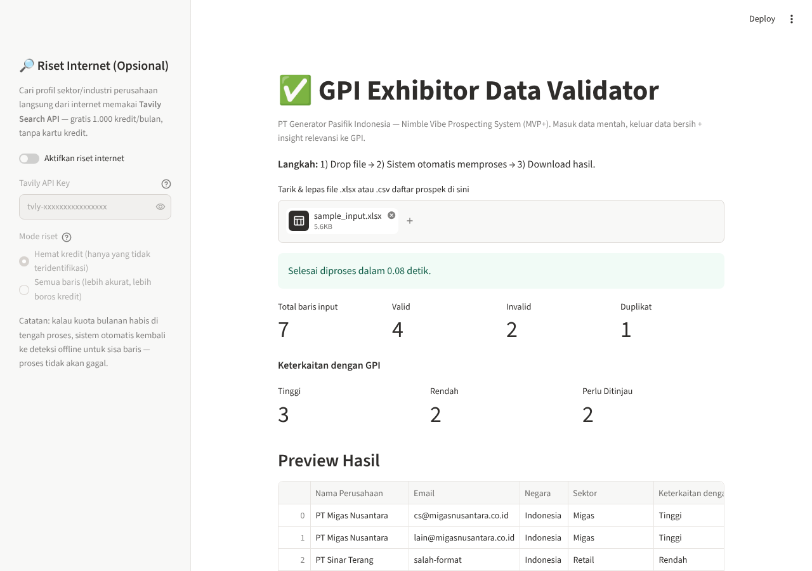

# Exhibitor Data Validator

Aplikasi Streamlit untuk membersihkan dan menilai daftar exhibitor pameran sebelum dipakai tim Business Development. Prinsipnya sederhana: masukkan file mentah, dapatkan file bersih. Sistem menandai duplikat, email dan negara yang tidak valid, mengisi sektor perusahaan, lalu menilai seberapa relevan setiap perusahaan dengan lini produk PT Generator Pasifik Indonesia.



## Tentang project ini

Project ini saya kerjakan selama magang di PT Generator Pasifik Indonesia. Setiap habis pameran industri, tim BD dapat daftar exhibitor yang isinya ratusan perusahaan dengan format berantakan: email salah, nama perusahaan dobel, nama negara ditulis macam-macam, dan kolom industri sering kosong. Memilah mana yang layak di-follow up masih dikerjakan manual.

Kebutuhannya saya tulis dulu dalam PRD singkat ([docs/PRD.md](docs/PRD.md)), lalu aplikasinya dibangun dengan pendekatan *vibe coding* bersama AI assistant. Peran saya di sini adalah menentukan aturan validasinya, menyusun pemetaan sektor ke target industri GPI, dan menguji hasilnya dengan file exhibitor sungguhan sampai outputnya bisa langsung dipakai tim.

Beberapa hal yang saya pelajari dari project ini:

- Data dari dunia nyata jarang rapi. Nama kolom dan isinya bisa sangat beragam, jadi pendeteksian kolom harus fleksibel.
- Menerjemahkan kebutuhan bisnis ("perusahaan ini relevan atau tidak buat kita?") menjadi aturan yang bisa dijelaskan.
- Memilih API pencarian yang realistis untuk dipakai gratis, dan merancang fallback kalau kuotanya habis.

## Fitur

- Upload `.xlsx` atau `.csv` dengan drag and drop. Hasil langsung bisa diunduh.
- Menghapus baris kosong dan menandai duplikat berdasarkan nama perusahaan atau email.
- Validasi format email (regex) dan nama negara (sekitar 249 negara lewat `pycountry`, ditambah alias berbahasa Indonesia seperti "Amerika Serikat" atau "Tiongkok").
- Mengisi kolom sektor yang kosong dari kata kunci nama perusahaan. Kalau file belum punya kolom sektor, kolom baru akan dibuat.
- Kolom **Keterkaitan dengan GPI** (`Tinggi`, `Rendah`, `Perlu Ditinjau`) beserta alasannya. Untuk skor Tinggi, alasannya dikaitkan ke produk GPI yang relevan, misalnya nitrogen untuk purging pipa di sektor migas.
- **Riset internet opsional** lewat Tavily Search API untuk perusahaan yang sektornya tidak bisa ditebak dari nama. Ringkasan hasil riset selalu ditampilkan dalam Bahasa Indonesia, lengkap dengan link sumbernya.
- Output Excel yang siap dipakai: header berwarna, kolom menyesuaikan isi, freeze pane, filter otomatis, dan warna per status.
- Pendeteksian nama kolom yang fleksibel. Variasi seperti "Exhibitor Name" atau "Industry / Product Category" tetap dikenali.

## Cara kerja penilaian

| Status | Arti |
|---|---|
| `Valid` | Email dan negara benar, bukan duplikat |
| `Invalid` | Format email salah, atau negara kosong/tidak dikenali |
| `Duplikat` | Nama perusahaan atau email sudah muncul di baris sebelumnya |

| Keterkaitan | Arti |
|---|---|
| `Tinggi` | Sektornya termasuk target industri GPI (migas, semen, baja, kimia, pembangkit listrik, F&B, kesehatan, pengolahan air limbah, manufaktur, energi terbarukan, green hydrogen, biofuel, data center, dan sebagainya) |
| `Rendah` | Sektornya diketahui, tapi di luar target GPI (misalnya retail atau perbankan) |
| `Perlu Ditinjau` | Sektornya belum bisa diidentifikasi, jadi perlu dicek manual |

Kolom Keterkaitan hanya bersifat informatif dan tidak memengaruhi kolom Status.

## Menjalankan

```bash
pip install -r requirements.txt
streamlit run app.py
```

Buka `http://localhost:8501`, lalu coba upload `contoh/sample_input.xlsx`. Hasil yang diharapkan ada di `contoh/sample_output.xlsx`.

### Mengaktifkan riset internet

1. Daftar di [app.tavily.com](https://app.tavily.com) dan salin API key-nya (`tvly-...`).
2. Nyalakan toggle **Aktifkan riset internet** di sidebar, lalu tempel API key-nya.
3. Supaya tidak perlu menempel ulang setiap kali, simpan key di `.streamlit/secrets.toml`:
   ```toml
   TAVILY_API_KEY = "tvly-xxxxxxxxxxxxxxxx"
   ```
   File ini sudah masuk `.gitignore`.

Ada dua mode riset. **Hemat kredit** hanya meriset baris yang tidak dikenali secara offline, sedangkan **Semua baris** meriset semuanya. Kalau kuota habis di tengah proses, aplikasi otomatis lanjut dengan deteksi offline, jadi prosesnya tidak gagal.

Saat project ini dibuat (September 2026), Tavily dipilih karena masih menyediakan 1.000 kredit gratis per bulan tanpa kartu kredit, sementara Google Custom Search sudah tidak menerima pengguna baru dan Brave Search mewajibkan kartu kredit.

## Keterbatasan

- Deteksi sektor offline memakai kamus kata kunci (`SECTOR_KEYWORDS` di `app.py`), bukan model AI. Nama perusahaan yang tidak mengandung kata kunci industri akan masuk `Perlu Ditinjau`. Ini disengaja, karena lebih baik jujur "belum tahu" daripada menebak salah.
- Cache hasil riset hanya bertahan selama aplikasi berjalan.
- Validasi email baru sebatas format, belum mengecek apakah domainnya benar-benar aktif.

## Struktur folder

```
.
├── app.py            aplikasi Streamlit dan logika validasi
├── requirements.txt
├── contoh/           file input dan output contoh (data dummy)
└── docs/             PRD dan screenshot
```

Tech stack: Python, Streamlit, pandas, openpyxl, pycountry, Tavily Search API.
